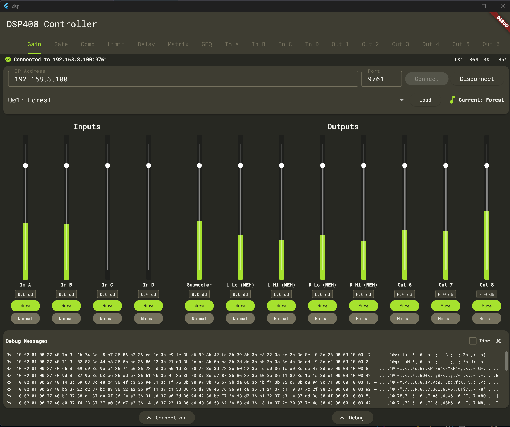
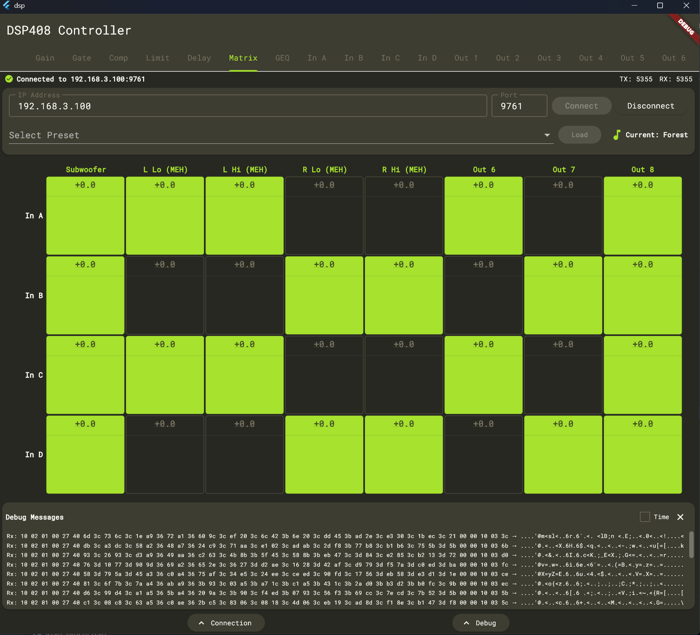
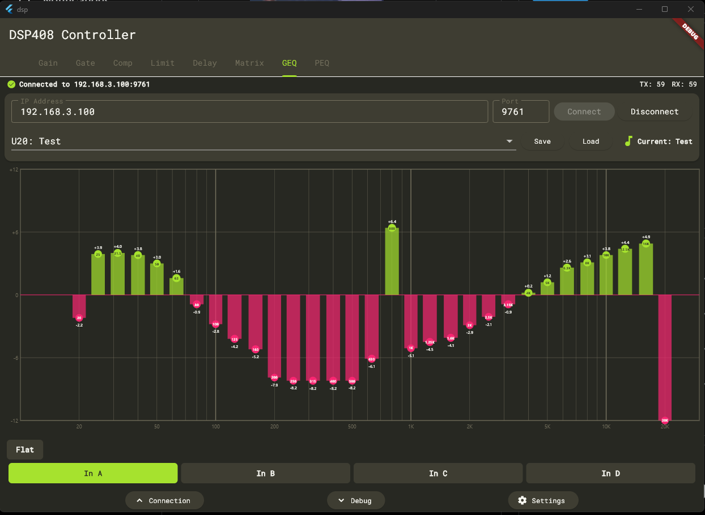

# dsp-408-ui

This application presents a neat and easy way to interface with the t.racks 408 Digital Signal Processor
(DSP). This software communicates over the local intranet and mimics communications sent by the t.racks
DSP Processor Editor software provided by Thomann. The goal is to turn one of the cheapest and most
versatile pieces of live music hardware into something that is capable of having robust mixing
functionality over a wide array of platforms.

The DSPs are controlled through a **web panel**: a small server (for example on an Ubuntu VM) holds the
connections to any number of DSPs, and every browser on the network can open the panel and manage the
DSPs in tabs. All browsers see the same state live.

```
Browser (Flutter web) ──HTTPS/WebSocket──▶ dsp-server ──TCP 9761──▶ DSP 1
Browser (Flutter web) ──────────────────▶            ──TCP 9761──▶ DSP 2 …
```







## Supported Platforms

**Server:** Linux x64/arm64 (tested on Ubuntu), runs as a systemd service.

**Panel:** any current desktop or mobile browser. The panel works without internet access – everything
(fonts, Flutter engine) is served by the panel server.

**Devices** (detected automatically, or chosen per DSP):
- t.racks DSP 408 (4 in / 8 out)
- t.racks DSP 206 (2 in / 6 out) – protocol from the
  [FlexiFlizz project](https://github.com/FlexiFlizz/t.racks-DSP-control); the configuration layout
  comes from the original 206 editor, see [PROTOCOL-RE.md](PROTOCOL-RE.md)
- t.racks DSP 204 (probably doesn't work yet--will work on this later)

The native apps (Windows, Android, …) in this repository are not adapted to the panel server.

## Features

Both models, every input and output, one tab per area (Gain · EQ · GEQ · Gate · Comp · Limit · Matrix ·
Delay · RTA). All faders look like console faders (dB scale, ridged cap) and every value can be typed in
directly.

- **Gain:** EQ overview of all channels above the faders (each EQ block exactly as wide as its fader block;
  every curve can be hidden with a checkbox, remembered per browser), faders with dB scale, mute and phase –
  inputs left, outputs right. Segmented level meters in dBFS (dim until the signal lights them up) with peak
  hold, clip indicator and the limiter status reported by the DSP, polled every 300 ms like the original editor
  (adjustable) while the DSP is shown
- **EQ:** channel selection In A … Out 8, PEQ graph over the full width (drag the points, scroll for Q),
  table of all bands (8 per input, 9 per output) with Freq/Q/Gain faders for the selected band, HPF and LPF
  (Butterworth, Bessel, Linkwitz-Riley up to 48 dB/oct) with bypass, EQ bypass for the whole channel, and the
  channel gain. Frequency, Q and their limits follow the original editor; the PEQ curves are drawn with the same
  formulas as the original editor (biquads at 48 kHz); bypassed bands show a dashed preview
- **GEQ** (31 bands, inputs): curve with one fader per band right below its point, bypass, RTA overlay and
  **Auto-EQ** (measure pink noise with a microphone, review the proposed correction, apply it). The EQ page has
  an Auto-EQ for every channel (e.g. per output for subs and tops) that uses the free PEQ bands; the other
  channels are muted while measuring, linked channels are measured together or alone
- **Gate** (inputs), **Compressor** and **Limiter** (outputs): transfer curve over the whole page,
  horizontal faders (value ranges and limiter knee like the original editor) and a live indicator while the DSP
  reduces the gain
- **Matrix:** routing diagram (inputs → outputs) next to the crossing grid; the gain of every crossing
  (−60 … 0 dB) is typed into its cell
- **Delay:** drag a speaker per channel (inputs left, outputs right), fine-tune with faders, ms, m or ft
  (stored on the DSP), zoomable range
- **RTA:** browser microphone, 1/24 octave, 16k FFT at 48 kHz, averaging Off/Fast/Slow/Long, peak hold;
  signal generator in the browser (sine, pink/white noise) and the DSP's own generator
- Every fader can be moved with the arrow keys after clicking it (Shift: 10 steps, Page Up/Down: 10 %)
- Channel menu (tap a channel name): rename (stored on the DSP, max. 8 characters), copy settings to other
  channels (the DSP copies, the panel reads the result back), link channels like the original editor: a master
  with one or more slaves that first get the master's settings (stored on the DSP). A change is sent once and
  the DSP applies it to the linked channels – the matrix routing stays per channel, so left/right pairs keep
  their inputs. Linked channels are highlighted together on every page
- **Presets:** the 20 presets stored on the DSP (load/store), plus a preset library on the server: save the
  current settings, edit a preset offline (without a DSP) in its own tab and load it onto any DSP of the
  same model
- Connection status per DSP, disconnect/connect without logging out of the panel. Device ID and the password of a
  DSP locked with the original editor are set per DSP

When connecting, the panel reads the complete configuration from the DSP before it shows it, including
mute, phase, delay, PEQ/EQ/GEQ bypass, the delay unit, the test tone and the matrix crossing gains. How the original
software works and what the panel does the same way is described in [ORIGINAL-SOFTWARE.md](ORIGINAL-SOFTWARE.md);
open hardware checks are collected in [TODO.md](TODO.md).

## Installing the panel on an Ubuntu server

1. Build the release package (see below) or download it from the GitHub release:
   `dsp-panel-<version>-linux-x64.tar.gz`.
2. Copy it to the server and install:
   ```
   $ tar xzf dsp-panel-<version>-linux-x64.tar.gz
   $ cd dsp-panel-<version>-linux-x64
   $ sudo ./install.sh
   ```
   The installer creates the service user `dsp-panel`, a self-signed TLS certificate, asks for the panel
   password and starts the `dsp-panel` service. Re-running it updates the program and keeps configuration,
   DSP list and password.
3. Open `https://<server-ip>:8443` in a browser. The browser warns once about the self-signed certificate –
   accept it. Log in and add your DSPs with the **+** next to the DSP tabs (IP address and port 9761).

If `ufw` is active: `sudo ufw allow 8443/tcp`. The server needs to reach the DSPs on TCP port 9761.

### Configuration

`/etc/dsp-panel/config.yaml` (restart with `sudo systemctl restart dsp-panel` after changes):

| Setting | Default | |
|---|---|---|
| `listen.port` | `8443` | `443` works too |
| `tls.enabled` | `true` | HTTPS is required for the RTA microphone in the browser |
| `tls.cert`, `tls.key` | self-signed | replace with your own certificate to avoid the browser warning |
| `auth.enabled` | `true` | `false` disables the login – then everyone on the network can control the DSPs |

- Change the password: `sudo dsp-panel-passwd` (logs out all browsers)
- Logs: `journalctl -u dsp-panel -f`
- Data (DSP list, server presets, password hash): `/var/lib/dsp-panel`
- Uninstall: `sudo ./uninstall.sh` (add `--purge` to also delete configuration and data)

Never expose the panel to the internet: the DSP protocol itself has no protection.

## Development

### Prerequisites
Ensure that Flutter is installed on your computer and available on your `$PATH`. You will need:
- Flutter - 3.38.9
- Dart - 3.10.8

Run setup:
```
$ make setup
```

### Project layout

| Folder | Contents |
|---|---|
| `packages/dsp_core` | Pure Dart: DSP 408 protocol (framing, commands, config parser), device state, web-panel API |
| `server` | Panel server: DSP connections, WebSocket API, login, HTTPS, static web client |
| `lib` | Flutter web client |
| `deploy` | Install script, systemd unit, example configuration |

### Running locally without hardware

```
$ make fake-dsp      # simulated DSP 408 on port 19761 and DSP 206 on port 19762
$ make build-web
$ make dev-server    # http://localhost:8080, no TLS, no login
```

Add the simulated DSPs in the panel with IP `127.0.0.1` and ports `19761` (DSP 408) / `19762` (DSP 206).

### Tests

```
$ make analyze
$ make test
```

### Building the release package
```
$ make dist
```
The package is at `./dist/dsp-panel-<version>-linux-x64.tar.gz` (use `tool/build_dist.sh arm64` for ARM
servers). The server binary is cross-compiled, so this also works on Windows (Git Bash) and macOS.
